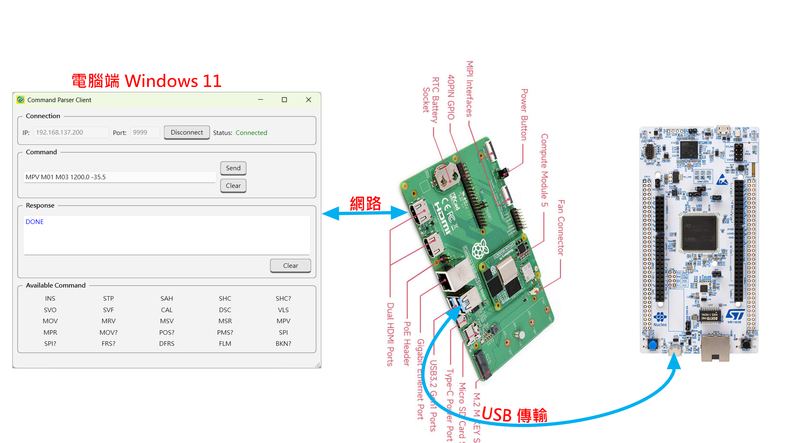

# GMT Command Gateway

A Linux-based TCP-to-USB command gateway running on Raspberry Pi CM5.

The gateway receives commands from a TCP client, validates them using the Command Parser, forwards valid commands to an STM32H755 over USB CDC, and returns the response received from the STM32 to the TCP client.

## 1. System Architecture

```text
Windows Qt Client
       |
       | TCP
       | 192.168.137.200:9999
       v
Raspberry Pi CM5
GMT Command Gateway
       |
       +-- TCP Server
       |
       +-- Command Parser
       |
       +-- USB Transport
       |
       | USB CDC
       | /dev/ttyACM0
       v
STM32H755
       |
       | USB CDC Response
       v
Raspberry Pi CM5
       |
       | TCP Response
       v
Windows Qt Client
```

## 2. Features

* TCP server listening on port `9999`.
* Command validation through the Command Parser.
* USB CDC communication with the STM32H755.
* Receives the actual response returned by the STM32.
* Forwards the response to the connected TCP client.
* Uses a synchronous command-response communication flow.

The gateway does not generate a simulated success response. The response returned to the TCP client comes from the USB response received from the STM32.

## 3. Hardware and Environment

### Gateway

* Platform: Raspberry Pi CM5
* Operating System: Debian GNU/Linux
* USB CDC device: `/dev/ttyACM0`
* TCP server port: `9999`

### Target Device

* MCU: STM32H755
* Communication interface: USB CDC

### Client

* Windows
* Qt-based TCP client
* Server address: `192.168.137.200`
* Server port: `9999`

The IP address shown above is the address used in the current test environment. Change it to match your network configuration when necessary.

## 4. Project Structure

```text
GMT_Command_Gateway/
├── include/
│   ├── command_parser.h
│   ├── tcp_server.h
│   └── usb_transport.hpp
├── src/
│   ├── command_parser.cpp
│   ├── main.cpp
│   ├── tcp_server.cpp
│   ├── transport_packet.cpp
│   └── usb_transport.cpp
├── CMakeLists.txt
├── .gitignore
└── README.md
```

This tree lists the principal files. Other project files may also be present.

## 5. Build

Install the required C++ compiler and CMake tools for your Linux environment.

From the project root:

```bash
cmake -S . -B build
cmake --build build
```

If the project has already been configured, rebuild it with:

```bash
cmake --build build
```

## 6. Run

Connect the STM32H755 to the Raspberry Pi CM5 through USB CDC.

Confirm that the device is available:

```bash
ls -l /dev/ttyACM0
```

Start the gateway:

```bash
./build/GMT_Command_Gateway
```

The server should listen on TCP port `9999`.

The USB device must be accessible to the user running the gateway.

## 7. Communication Flow

For each command, the gateway performs the following operations:

1. Receives a command from the TCP client.
2. Validates the command using the Command Parser.
3. Sends a valid command to the STM32H755 over USB CDC.
4. Waits for the USB response.
5. Forwards the received response to the TCP client.

The TCP response includes a CRLF line terminator (`\r\n`) so that the current Qt client can process the response using its line-based receive logic.

The gateway uses a synchronous command-response flow. Do not assume that multiple simultaneous client sessions or asynchronous command processing are supported.

## 8. Verified Hardware Tests

The following commands have been tested through the Windows Qt client, Raspberry Pi CM5 gateway, and STM32H755 hardware.

| Command                     | Observed Response |
| --------------------------- | ----------------- |
| `SPI R U 10 5 2`            | `DONE`            |
| `MOV R 1000 1000 500 0 0 0` | `DONE`            |
| `MPV M01 M03 1200.0 -35.5`  | `DONE`            |

All three tests successfully returned the response to the Qt client's Response field.

These results document the tests performed in the current hardware setup. They do not imply that every command or error-handling scenario has been tested.

## 9. Troubleshooting

### TCP connection fails

Check that:

* The Raspberry Pi CM5 is reachable from the client.
* The gateway is running.
* TCP port `9999` is reachable.
* No other process is occupying the port.

### USB device is unavailable

Check the connected USB CDC device:

```bash
ls -l /dev/ttyACM0
```

Verify the device path and access permissions.

### The client does not display a response

Check the gateway log for:

* Command reception.
* Parser validation.
* USB transmission.
* USB response reception.
* TCP response transmission.

Also verify that the TCP client handles the CRLF line terminator correctly.

## 10. Scope and Limitations

This project provides the TCP-to-USB command gateway for the current STM32H755 system.

The following behaviors should be tested separately before claiming full production readiness:

* USB device disconnect and reconnect.
* STM32 response timeout or missing response.
* TCP client disconnect during command execution.
* Invalid command handling.
* Repeated commands and long-running sessions.
* Multiple simultaneous client connections, if required.

## 運作圖



## 編譯

```bash
cd ~/GMT_Command_Gateway || exit 1
cmake --build build
```
 
## Raspberry Pi CM5 端 執行程式 

```bash
herman@RPiCM5:~/GMT_Command_Gateway $ ./build/GMT_Command_Gateway

```
## 使用 Powershell 執行的命令

```
操作 1：開啟 Windows PowerShell

操作 2：連線到 CM5

$client = [System.Net.Sockets.TcpClient]::new()
$client.Connect("192.168.137.200", 9999)
$stream = $client.GetStream()
$stream.ReadTimeout = 10000

操作 3：傳送測試命令

$command = "MOV R 1000 1000 500 0 0 0`n"
$bytes = [System.Text.Encoding]::ASCII.GetBytes($command)
$stream.Write($bytes, 0, $bytes.Length)
$stream.Flush()

操作 4：接收 STM32 Response

$buffer = New-Object byte[] 1024
$count = $stream.Read($buffer, 0, $buffer.Length)

if ($count -gt 0) {
    $response = [System.Text.Encoding]::ASCII.GetString($buffer, 0, $count)
    Write-Host "TCP Response: [$response]"
}

預期結果

如果 STM32H755 正常回覆，應該看到類似：

TCP Response: [DONE]
```

## 運作流程 

```
Qt Client (Windows 11) ↔ 網路連接 ↔ Raspberry Pi CM5 ↔ USB 連接 ↔ STM32H755 MCU
先連上線，傳送命令，例如：
    SPI R U 10 5 2	
	MOV R 1000 1000 500 0 0 0	
	MPV M01 M03 1200.0 -35.5
這些命令最終會傳送到 MCU，由 MCU 傳送 Response 到 Qt Client GUI 的 Response 欄位
```

