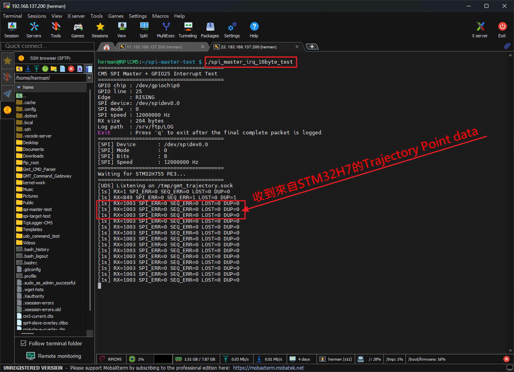
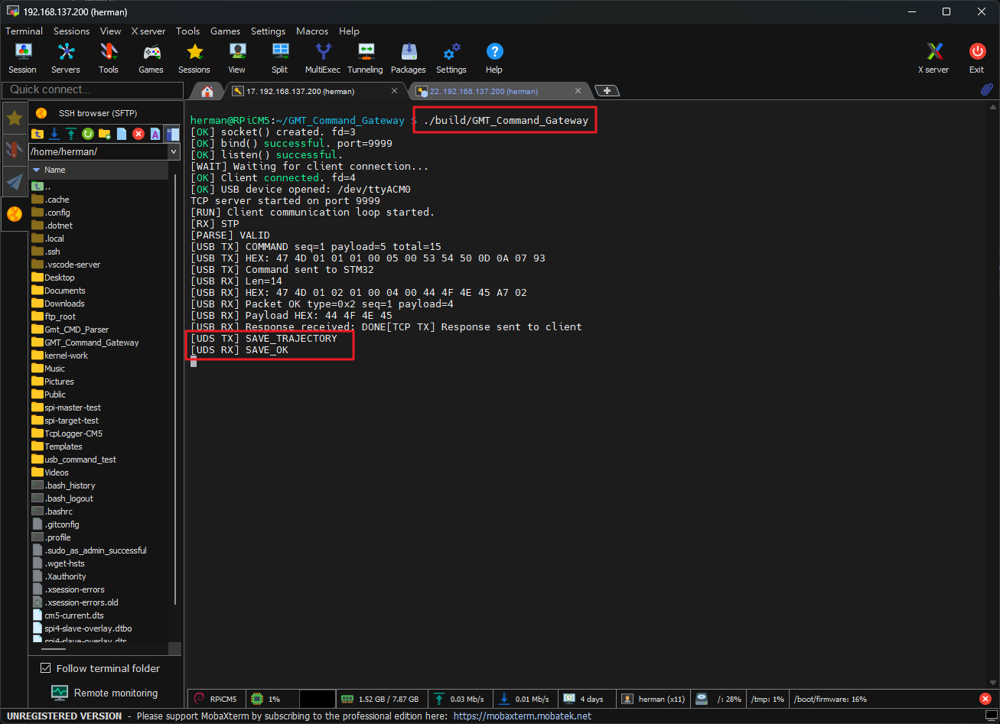
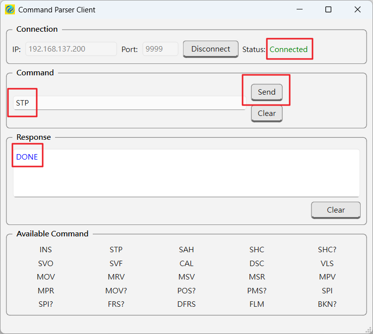
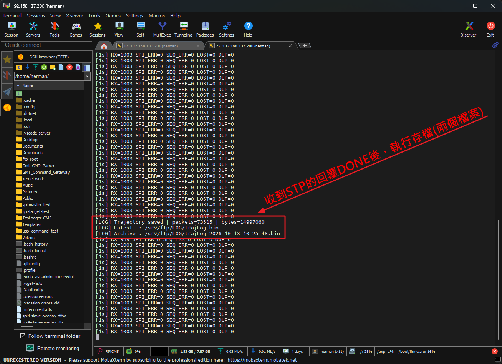
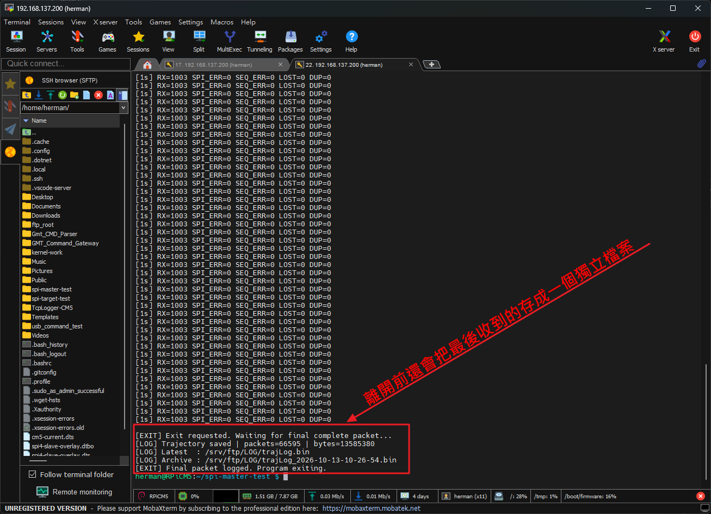

# GMT Command Gateway

A Linux-based TCP-to-USB command gateway running on Raspberry Pi CM5.

The gateway receives commands from a TCP client, validates them using the Command Parser, forwards valid commands to an STM32H755 over USB CDC, and returns the response received from the STM32 to the TCP client.

## 1. System Architecture

```text
Windows Qt Client
       |
       | TCP
       | 192.168.137.200:9999
       v
Raspberry Pi CM5
GMT Command Gateway
       |
       +-- TCP Server
       |
       +-- Command Parser
       |
       +-- USB Transport
       |
       | USB CDC
       | /dev/ttyACM0
       v
STM32H755
       |
       | USB CDC Response
       v
Raspberry Pi CM5
       |
       | TCP Response
       v
Windows Qt Client
```

## 2. Features

* TCP server listening on port `9999`.
* Command validation through the Command Parser.
* USB CDC communication with the STM32H755.
* Receives the actual response returned by the STM32.
* Forwards the response to the connected TCP client.
* Uses a synchronous command-response communication flow.

The gateway does not generate a simulated success response. The response returned to the TCP client comes from the USB response received from the STM32.

## 3. Hardware and Environment

### Gateway

* Platform: Raspberry Pi CM5
* Operating System: Debian GNU/Linux
* USB CDC device: `/dev/ttyACM0`
* TCP server port: `9999`

### Target Device

* MCU: STM32H755
* Communication interface: USB CDC

### Client

* Windows
* Qt-based TCP client
* Server address: `192.168.137.200`
* Server port: `9999`

The IP address shown above is the address used in the current test environment. Change it to match your network configuration when necessary.

## 4. Project Structure

```text
GMT_Command_Gateway/
├── include/
│   ├── command_parser.h
│   ├── tcp_server.h
│   └── usb_transport.hpp
├── src/
│   ├── command_parser.cpp
│   ├── main.cpp
│   ├── tcp_server.cpp
│   ├── transport_packet.cpp
│   └── usb_transport.cpp
├── CMakeLists.txt
├── .gitignore
└── README.md
```

This tree lists the principal files. Other project files may also be present.

## 5. Build

Install the required C++ compiler and CMake tools for your Linux environment.

From the project root:

```bash
cmake -S . -B build
cmake --build build
```

If the project has already been configured, rebuild it with:

```bash
cmake --build build
```

## 6. Run

Connect the STM32H755 to the Raspberry Pi CM5 through USB CDC.

Confirm that the device is available:

```bash
ls -l /dev/ttyACM0
```

Start the gateway:

```bash
./build/GMT_Command_Gateway
```

The server should listen on TCP port `9999`.

The USB device must be accessible to the user running the gateway.

## 7. Communication Flow

For each command, the gateway performs the following operations:

1. Receives a command from the TCP client.
2. Validates the command using the Command Parser.
3. Sends a valid command to the STM32H755 over USB CDC.
4. Waits for the USB response.
5. Forwards the received response to the TCP client.

The TCP response includes a CRLF line terminator (`\r\n`) so that the current Qt client can process the response using its line-based receive logic.

The gateway uses a synchronous command-response flow. Do not assume that multiple simultaneous client sessions or asynchronous command processing are supported.

## 8. Verified Hardware Tests

The following commands have been tested through the Windows Qt client, Raspberry Pi CM5 gateway, and STM32H755 hardware.

| Command                     | Observed Response |
| --------------------------- | ----------------- |
| `SPI R U 10 5 2`            | `DONE`            |
| `MOV R 1000 1000 500 0 0 0` | `DONE`            |
| `MPV M01 M03 1200.0 -35.5`  | `DONE`            |

All three tests successfully returned the response to the Qt client's Response field.

These results document the tests performed in the current hardware setup. They do not imply that every command or error-handling scenario has been tested.

## 9. Troubleshooting

### TCP connection fails

Check that:

* The Raspberry Pi CM5 is reachable from the client.
* The gateway is running.
* TCP port `9999` is reachable.
* No other process is occupying the port.

### USB device is unavailable

Check the connected USB CDC device:

```bash
ls -l /dev/ttyACM0
```

Verify the device path and access permissions.

### The client does not display a response

Check the gateway log for:

* Command reception.
* Parser validation.
* USB transmission.
* USB response reception.
* TCP response transmission.

Also verify that the TCP client handles the CRLF line terminator correctly.

## 10. Scope and Limitations

This project provides the TCP-to-USB command gateway for the current STM32H755 system.

The following behaviors should be tested separately before claiming full production readiness:

* USB device disconnect and reconnect.
* STM32 response timeout or missing response.
* TCP client disconnect during command execution.
* Invalid command handling.
* Repeated commands and long-running sessions.
* Multiple simultaneous client connections, if required.

## 運作圖


## 編譯

```bash
cd ~/GMT_Command_Gateway || exit 1
cmake --build build
```
 
## Raspberry Pi CM5 端 執行程式 

```bash
herman@RPiCM5:~/GMT_Command_Gateway $ ./build/GMT_Command_Gateway

```
## 使用 Powershell 執行的命令

```
操作 1：開啟 Windows PowerShell

操作 2：連線到 CM5

$client = [System.Net.Sockets.TcpClient]::new()
$client.Connect("192.168.137.200", 9999)
$stream = $client.GetStream()
$stream.ReadTimeout = 10000

操作 3：傳送測試命令

$command = "MOV R 1000 1000 500 0 0 0`n"
$bytes = [System.Text.Encoding]::ASCII.GetBytes($command)
$stream.Write($bytes, 0, $bytes.Length)
$stream.Flush()

操作 4：接收 STM32 Response

$buffer = New-Object byte[] 1024
$count = $stream.Read($buffer, 0, $buffer.Length)

if ($count -gt 0) {
    $response = [System.Text.Encoding]::ASCII.GetString($buffer, 0, $count)
    Write-Host "TCP Response: [$response]"
}

預期結果

如果 STM32H755 正常回覆，應該看到類似：

TCP Response: [DONE]
```

## 運作流程 

```
Qt Client (Windows 11) ↔ 網路連接 ↔ Raspberry Pi CM5 ↔ USB 連接 ↔ STM32H755 MCU
先連上線，傳送命令，例如：
    SPI R U 10 5 2	
	MOV R 1000 1000 500 0 0 0	
	MPV M01 M03 1200.0 -35.5
這些命令最終會傳送到 MCU，由 MCU 傳送 Response 到 Qt Client GUI 的 Response 欄位
```
# [2026-10-13] 更新

# GMT Command Gateway

GMT Command Gateway is a TCP-to-USB command gateway running on a Raspberry Pi Compute Module 5 (CM5).

It receives commands from a PC TCP client, forwards them to an STM32H755 microcontroller through USB CDC, and returns the microcontroller's response to the TCP client.

The gateway also integrates a Unix Domain Socket (UDS) client for trajectory logging. When an `STP` command receives a response containing `DONE` from the STM32, the gateway forwards the TCP response to the PC client first, then requests trajectory data to be saved by the UDS server.

## Features

* TCP server for PC command clients.
* USB CDC communication with STM32H755.
* Command parsing and validation.
* TCP response forwarding.
* Unix Domain Socket (UDS) integration for trajectory logging.
* Conditional trajectory-save requests triggered by successful `STP` responses.
* Separate handling of TCP responses and UDS save results.
* Console logging for TCP, USB, and UDS operations.

## System Architecture

```text
+------------------------+
| PC Qt Command Client   |
| TCP Client             |
+-----------+------------+
            |
            | TCP
            | Port 9999
            v
+------------------------+
| Raspberry Pi CM5       |
| GMT_Command_Gateway   |
|                        |
| TCP Server             |
| Command Parser         |
| USB CDC Client         |
| UDS Client             |
+-----------+------------+
            |
            | USB CDC
            v
+------------------------+
| STM32H755              |
| USB CDC Device         |
| Command Processing     |
+------------------------+

Trajectory Logging:

GMT_Command_Gateway
          |
          | Unix Domain Socket
          | /tmp/gmt_trajectory.sock
          | SAVE_TRAJECTORY
          v
+------------------------+
| spi-master-test        |
| UDS Server             |
| Trajectory Logging     |
+------------------------+
          |
          v
Trajectory Log Files
```

## Hardware and Software

### Hardware

* Raspberry Pi Compute Module 5 (CM5)
* STM32H755 microcontroller
* USB CDC connection between CM5 and STM32H755
* PC running the Qt Command Client

### Software

* Linux on Raspberry Pi CM5
* C++
* CMake
* USB CDC device interface
* TCP/IP networking
* Unix Domain Socket (UDS)

### Default Configuration

| Item                 | Configuration              |
| -------------------- | -------------------------- |
| TCP server port      | `9999`                     |
| USB CDC device       | `/dev/ttyACM0`             |
| UDS socket           | `/tmp/gmt_trajectory.sock` |
| UDS save command     | `SAVE_TRAJECTORY\n`        |
| UDS success response | `SAVE_OK\n`                |
| UDS failure response | `SAVE_ERROR\n`             |

The USB device path and TCP port must match the actual runtime configuration.

## Command Processing Flow

The gateway processes commands in the following order:

1. Accept a TCP connection from the PC client.
2. Receive a command from the client.
3. Parse and validate the command.
4. Package the command and transmit it to the STM32 through USB CDC.
5. Receive and validate the STM32 response packet.
6. Return the response to the PC client.
7. If the command and response satisfy the trajectory-save condition, request trajectory logging through UDS.

The UDS result is reported in the gateway console. It does not replace the response already returned to the PC client.

## UDS Trajectory Logging Integration

### Purpose

The UDS integration allows the gateway to request trajectory data to be saved by the separate `spi-master-test` application.

The gateway does not directly write the trajectory log file. Instead, it sends a request to the UDS server, which handles the save operation.

### Trigger Condition

A trajectory-save request is issued only when both conditions are satisfied:

* The parsed command is `STP`.
* The STM32 response contains the uppercase string `DONE`.

Other commands do not trigger this save request.

### UDS Protocol

The gateway connects to the following Unix Domain Socket:

```text
/tmp/gmt_trajectory.sock
```

It sends:

```text
SAVE_TRAJECTORY\n
```

The UDS server returns one of the following:

| Response       | Meaning                             |
| -------------- | ----------------------------------- |
| `SAVE_OK\n`    | Trajectory save operation succeeded |
| `SAVE_ERROR\n` | Trajectory save operation failed    |

The gateway also reports connection, transmission, reception, timeout, and invalid-response errors.

### Execution Order

For an `STP` command that satisfies the trigger condition:

```text
PC Client
    |
    | STP
    v
GMT_Command_Gateway
    |
    | USB CDC command
    v
STM32H755
    |
    | DONE
    v
GMT_Command_Gateway
    |
    +----> Return response to PC client
    |
    +----> Send SAVE_TRAJECTORY through UDS
                    |
                    v
             spi-master-test
                    |
                    +----> Save trajectory data
                    |
                    +----> Return SAVE_OK or SAVE_ERROR
```

The TCP response is sent before the gateway performs the UDS save request.

The UDS result is logged locally by the gateway and is not substituted for the TCP response.

## Building

Run the following commands from the project root directory:

```bash
cmake -S . -B build
cmake --build build
```

The resulting executable is:

```text
build/GMT_Command_Gateway
```

## Running

### Prerequisites

Before starting the gateway, ensure that:

* The STM32H755 is powered and running the appropriate firmware.
* The USB CDC device is available on the CM5.
* The PC can connect to the CM5 on TCP port `9999`.
* If trajectory logging is required, `spi-master-test` is running and its UDS socket is available.

### Startup Order

**1. Start the UDS server**

On the CM5:

```bash
cd ~/spi-master-test
./spi_master_irq_16byte_test
```

Wait for the server to report that it is listening on:

```text
/tmp/gmt_trajectory.sock
```

**2. Start the STM32H755**

Ensure that the STM32H755 is running and that the required trajectory data is available to the logging application.

**3. Start the gateway**

On the CM5:

```bash
cd ~/GMT_Command_Gateway
./build/GMT_Command_Gateway
```

The gateway listens for TCP client connections on port `9999`.

**4. Connect the PC client**

Configure the PC Qt Command Client to connect to the CM5's IP address on TCP port `9999`.

Commands can then be sent through the gateway to the STM32H755.

## Console Logging

The gateway reports its communication activity through the console.

Representative log messages include:

```text
[RX] STP
[PARSE] VALID
[USB TX] COMMAND seq=1 payload=5 total=15
[USB RX] Packet OK type=0x2 seq=1 payload=4
[USB RX] Payload HEX: 44 4F 4E 45
[USB RX] Response received: DONE
[TCP TX] Response sent to client
[UDS TX] SAVE_TRAJECTORY
[UDS RX] SAVE_OK
```

The exact sequence number and packet details depend on the current session.

Important UDS log messages:

| Log                             | Meaning                                         |
| ------------------------------- | ----------------------------------------------- |
| `[UDS TX] SAVE_TRAJECTORY`      | The gateway is requesting a trajectory save     |
| `[UDS RX] SAVE_OK`              | The UDS server reports success                  |
| `[UDS RX] SAVE_ERROR`           | The UDS server reports a save failure           |
| `[UDS ERROR] Connection failed` | The gateway could not connect to the UDS server |
| `[UDS ERROR] Send failed`       | The UDS request could not be sent               |
| `[UDS ERROR] Receive failed`    | The UDS response could not be received          |
| `[UDS ERROR] Timeout`           | The UDS operation timed out                     |
| `[UDS ERROR] Invalid response`  | The UDS server returned an unexpected response  |

## Verification Status

The following functions have been verified in the development environment.

| Test                                       | Result |
| ------------------------------------------ | ------ |
| CMake configuration and build              | PASS   |
| TCP client connection                      | PASS   |
| USB CDC communication with STM32H755       | PASS   |
| Command parsing and forwarding             | PASS   |
| STM32 response reception                   | PASS   |
| TCP response delivery                      | PASS   |
| `STP`-triggered UDS save request           | PASS   |
| UDS save success response                  | PASS   |
| Repeated `STP` save requests               | PASS   |
| `INS 1` does not trigger trajectory saving | PASS   |
| `SVO` does not trigger trajectory saving   | PASS   |

The UDS save workflow was tested repeatedly on the actual hardware. Four consecutive `STP` requests completed with `SAVE_OK`, and the trajectory logging application reported successfully saved log files.

The `INS 1` and `SVO` tests also confirmed that non-`STP` commands could receive the STM32 response without triggering the UDS save operation.

These results describe the tested development configuration and do not imply verification of every possible command or failure scenario.

## Troubleshooting

### USB CDC Device Not Found

Check whether the USB device exists:

```bash
ls -l /dev/ttyACM0
```

Verify that the STM32H755 is powered, running the correct firmware, and connected to the CM5.

### TCP Client Cannot Connect

Check that the gateway is running and listening on TCP port `9999`.

Verify the CM5 IP address, network connectivity, and client configuration.

### UDS Connection Failed

Check whether the UDS server is running:

```bash
ls -l /tmp/gmt_trajectory.sock
```

If the socket is unavailable, start `spi-master-test` and wait for its listening message before sending an `STP` command.

### UDS Save Request Does Not Appear

The gateway issues a save request only when the parsed command is `STP` and the STM32 response contains uppercase `DONE`.

Check the gateway console to verify the command and response.

### UDS Save Error or Timeout

Check the `spi-master-test` console for the corresponding request and save result. Also verify that the UDS server is operational and that the trajectory data source is available.

## Project Scope

GMT_Command_Gateway is responsible for:

* Receiving commands from a PC over TCP.
* Parsing and forwarding commands.
* Communicating with the STM32H755 through USB CDC.
* Returning STM32 responses to the PC.
* Requesting trajectory logging through UDS when the defined trigger condition is satisfied.

The separate `spi-master-test` application is responsible for handling UDS save requests and performing the trajectory logging operation.

The STM32 firmware remains responsible for processing the commands it receives.

## License

No license has been specified in this README. Add an appropriate license before distributing the project if required.


# 運作方式

```
1. 先啟動 在 Raspberry Pi CM5 的獨立執行程式  ./spi_master_irq_16byte_test 

========================================
CM5 SPI Master + GPIO25 Interrupt Test
========================================
GPIO chip : /dev/gpiochip0
GPIO line : 25
Edge      : RISING
SPI device: /dev/spidev0.0
SPI mode  : 0
SPI speed : 12000000 Hz
RX size   : 204 bytes
Log path  : /srv/ftp/LOG
Exit      : Press 'q' to exit after the final complete packet is logged
========================================
[SPI] Device       : /dev/spidev0.0
[SPI] Mode         : 0
[SPI] Bits         : 8
[SPI] Speed        : 12000000 Hz
========================================
Waiting for STM32H755 PE3...
========================================
[UDS] Listening on /tmp/gmt_trajectory.sock     <<<<<-- Unix Domain Socket（UDS） 

```

```
2. 把 STM32H755 開發板上電或是按下開發板上的 RESET 按鍵。SSH Terminal 會出現 抓取 TRAJECTORY POINT DATA 。

herman@RPiCM5:~/spi-master-test $ ./spi_master_irq_16byte_test
========================================
CM5 SPI Master + GPIO25 Interrupt Test
========================================
GPIO chip : /dev/gpiochip0
GPIO line : 25
Edge      : RISING
SPI device: /dev/spidev0.0
SPI mode  : 0
SPI speed : 12000000 Hz
RX size   : 204 bytes
Log path  : /srv/ftp/LOG
Exit      : Press 'q' to exit after the final complete packet is logged
========================================
[SPI] Device       : /dev/spidev0.0
[SPI] Mode         : 0
[SPI] Bits         : 8
[SPI] Speed        : 12000000 Hz
========================================
Waiting for STM32H755 PE3...
========================================
[UDS] Listening on /tmp/gmt_trajectory.sock       <<<<<-- Unix Domain Socket（UDS）
[1s] RX=1003 SPI_ERR=0 SEQ_ERR=0 LOST=0 DUP=0 
[1s] RX=1003 SPI_ERR=0 SEQ_ERR=0 LOST=0 DUP=0 
[1s] RX=1003 SPI_ERR=0 SEQ_ERR=0 LOST=0 DUP=0

```

```
3. 啟動 GMT_Command_Gateway

herman@RPiCM5:~/GMT_Command_Gateway $ ./build/GMT_Command_Gateway
[OK] socket() created. fd=3
[OK] bind() successful. port=9999
[OK] listen() successful.
[WAIT] Waiting for client connection...
[OK] Client connected. fd=4
[OK] USB device opened: /dev/ttyACM0
TCP server started on port 9999
[RUN] Client communication loop started.

```

```
4. 啟動電腦端的 Qt Command Client GUI
在 Command 欄位輸入 STP 後，按下 Send 按鍵，會出現 Response DONE。
觀察 spi-master-test 視窗，會發現出現 儲存檔案的 Log 輸出。
```

## 遇上無法再啟動連線 問題
```
問題狀況： [UDS] Failed to bind /tmp/gmt_trajectory.sock: Address already in use

處理方法：

刪除殘留的 Socket 檔案
rm /tmp/gmt_trajectory.sock

確認檔案已刪除：
ls -l /tmp/gmt_trajectory.sock

預期會顯示：
ls: cannot access '/tmp/gmt_trajectory.sock': No such file or directory

再重新啟動 ./spi_master_irq_16byte_test
```

## 運作圖












